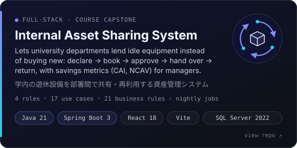

 

🇬🇧 English &nbsp;·&nbsp; 🇯🇵 日本語 &nbsp;—&nbsp; side by side below &nbsp;|&nbsp; 🇻🇳 <a href="#-tiếng-việt">Tiếng Việt ↓</a>

 

## 👋 About · 自己紹介

<table>
<tr>
<td width="50%" valign="top">

Hi, I'm **Trần Nguyên** — a Software Engineering student at **Ho Chi Minh City University of Natural Resources and Environment (HCMUNRE)**, enrolled in 2023.

I've built full-stack apps with Java/Spring Boot, Python/Django and React. Now I'm going deep into **DevSecOps**: automating delivery and building security into every stage of the pipeline instead of bolting it on at the end.

- 🔭 **Now:** hardening my own projects with CI security gates (secret scan, SAST, dependency audit)
- 🌱 **Learning:** Docker, GitHub Actions, AWS, Terraform, Kubernetes
- 🇯🇵 **Goal:** a DevSecOps career with a Japanese company — in Vietnam or in Japan
- 🤝 **Open to:** internship & fresher roles

</td>
<td width="50%" valign="top">

こんにちは、**チャン・グエン（Trần Nguyên）** です。**ホーチミン市天然資源環境大学（HCMUNRE）** でソフトウェア工学を専攻しています（2023年入学）。

Java/Spring Boot、Python/Django、React でのフルスタック開発の経験をもとに、現在は **DevSecOps** に力を入れています。セキュリティを最後に付け足すのではなく、パイプラインのすべての段階に組み込むことを目指しています。

- 🔭 **現在：** 自分のプロジェクトに CI セキュリティチェック（シークレットスキャン・SAST・依存関係監査）を導入中
- 🌱 **学習中：** Docker、GitHub Actions、AWS、Terraform、Kubernetes
- 🇯🇵 **目標：** 日本企業で DevSecOps エンジニアとして働くこと（ベトナム・日本どちらでも）
- 🤝 **希望：** インターンシップ・新卒採用の機会を探しています

</td>
</tr>
</table>

## 🛡️ What I care about · 大切にしていること

| | English | 日本語 |
|---|---|---|
| 🛡️ **Shift-left security** | Catch leaked secrets, vulnerable dependencies and misconfigurations *before* merge | マージ前にシークレット漏洩・脆弱な依存関係・設定ミスを検出する |
| ⚙️ **Automate everything** | Repeatable pipelines over manual, error-prone steps | 手作業ではなく、再現性のあるパイプラインで |
| 🧱 **Infrastructure as Code** | Infra that is version-controlled, reviewed and tested like app code | インフラもアプリと同じくバージョン管理・レビュー・テストする |
| 📈 **Observability** | You can't secure what you can't see | 見えないものは守れない |

## 🧰 Tech Stack · 技術スタック

**Built projects with · 開発で使用**

  

**DevSecOps track — learning · 学習中**

  

**Security tooling · セキュリティツール** &nbsp; `Gitleaks` `Trivy` `SonarQube` `Semgrep` `OWASP ZAP` `Dependabot`

## 🚀 Featured Projects · 主なプロジェクト

  
  

<b>🗺️ Urban Incident Alert Map — why I built it · 開発の背景</b>

 

**EN —** During floods in Vietnam, volunteers built simple websites where people could post calls for help on a map. I took that idea and turned it toward everyday city problems: residents report an incident (flooding, broken street lights, road hazards) with a location and photo, and police or support teams see every report on one shared map, so the response is based on data rather than on who shouts loudest.

🔐 **DevSecOps hardening (team project, security work by me):** fixed a stored XSS, CSRF on admin actions, an open redirect and a hard-coded `SECRET_KEY`; upgraded dependencies with 101 known vulnerabilities; added a CI pipeline (gitleaks → bandit → pip-audit → tests on PostGIS → `check --deploy`).

**JP —** ベトナムの洪水の際、ボランティアが地図上で救助要請を共有できるサイトを作っていました。その発想を日常の都市問題に応用し、住民が位置情報と写真付きでトラブル（冠水、街灯の故障、道路の危険など）を通報し、警察や支援チームが一つの地図上で客観的に状況を把握・対応できるシステムを開発しました。

🔐 **DevSecOps 強化（チーム開発・セキュリティ部分を担当）：** 格納型 XSS、管理機能の CSRF、オープンリダイレクト、ハードコードされた `SECRET_KEY` を修正し、既知の脆弱性 101 件を含む依存関係を更新。さらに CI パイプライン（gitleaks → bandit → pip-audit → PostGIS 上のテスト → `check --deploy`）を構築しました。

`Django 5.2` `GeoDjango` `PostGIS` `Leaflet` `Leaflet.heat` `Leaflet Routing` `Turf.js` `GitHub Actions` `gitleaks` `bandit` `pip-audit`

<b>📦 Internal Asset Sharing System — details · 詳細</b>

 

**EN —** Capstone for the Object-Oriented Software Development course. Departments declare idle equipment, others book it, managers approve, and the system tracks hand-over, return, wear and maintenance across a 7-state lifecycle. A nightly job flags overdue loans and cancels no-shows. Two metrics — CAI (avoided purchases) and NCAV (net savings) — show the value of sharing.

**JP —** オブジェクト指向ソフトウェア開発の授業の最終課題です。部署が遊休設備を登録し、他部署が予約、管理者が承認し、貸出・返却・摩耗・保守までを7つの状態で管理します。毎晩の自動処理で延滞を検知し、未受領の予約を自動キャンセルします。CAI（新規購入回避指数）と NCAV（純節約額）で共有の効果を可視化します。

`Java 21` `Spring Boot 3` `Spring Data JPA` `React 18` `Vite` `Tailwind CSS` `SQL Server 2022`

## 🤝 Let's connect · 連絡先

  
  <!-- Bỏ comment và điền link thật khi sẵn sàng / Uncomment when ready:
  
  
  -->

Happy to talk about DevSecOps, internships, or working in Japan. · DevSecOps、インターンシップ、日本での就職について、気軽にご連絡ください。

---

## 🇻🇳 Tiếng Việt

<b>Bấm để xem bản tiếng Việt</b>

 

### Giới thiệu

Mình là **Trần Nguyên**, sinh viên ngành Công nghệ phần mềm tại **Trường Đại học Tài nguyên và Môi trường TP.HCM (HCMUNRE)**, khóa 2023.

Mình đã làm các ứng dụng full-stack với Java/Spring Boot, Python/Django và React. Hiện tại mình tập trung vào **DevSecOps**: tự động hóa quy trình triển khai và đưa bảo mật vào từng giai đoạn của pipeline, thay vì đợi đến cuối mới kiểm tra.

- 🔭 **Hiện tại:** đưa các bước kiểm tra bảo mật (quét secret, SAST, audit thư viện) vào CI cho các project của mình
- 🌱 **Đang học:** Docker, GitHub Actions, AWS, Terraform, Kubernetes
- 🇯🇵 **Mục tiêu:** làm DevSecOps tại công ty Nhật, ở Việt Nam hoặc sang Nhật
- 🤝 **Đang tìm:** cơ hội thực tập và fresher

### Điều mình coi trọng

- 🛡️ **Shift-left security:** phát hiện lộ secret, thư viện có lỗ hổng và cấu hình sai *trước khi* merge
- ⚙️ **Tự động hóa:** pipeline lặp lại được, thay cho thao tác thủ công dễ sai
- 🧱 **Infrastructure as Code:** hạ tầng cũng được quản lý phiên bản, review và kiểm thử như code
- 📈 **Observability:** không nhìn thấy thì không bảo vệ được

### Dự án nổi bật

- **[Bản đồ cảnh báo sự cố đô thị](https://github.com/trannguyennee/DuAnGisMoi):** lấy cảm hứng từ các trang cầu cứu trên bản đồ trong mùa lũ. Người dân gửi phản ánh sự cố (ngập, hỏng đèn đường, nguy hiểm giao thông) kèm vị trí và ảnh; cảnh sát và đơn vị hỗ trợ theo dõi mọi phản ánh trên cùng một bản đồ để xử lý khách quan hơn. Có heatmap, chỉ đường tới hiện trường, API quét theo vùng, xuất Excel và trang quản trị duyệt tin.
- **[Hệ thống chia sẻ tài sản nội bộ (ENV-09)](https://github.com/trannguyennee/ENV09_ChiaSeTaiSan):** đồ án môn OOSD. Số hóa quy trình khai báo, đặt mượn, duyệt, bàn giao và thu hồi thiết bị nhàn rỗi giữa các khoa; tính chỉ số CAI và NCAV để đo hiệu quả chia sẻ.

 

🔐 This profile repo runs its own pipeline on every push: <b>gitleaks</b> secret scan + SVG validation · このプロフィール自体も push ごとにシークレットスキャンを実行しています

